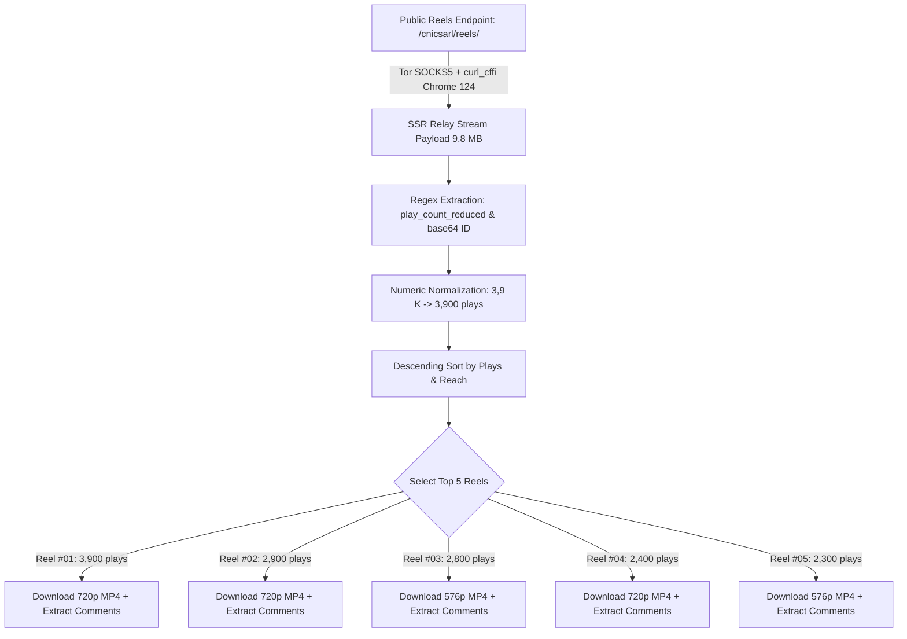

# Facebook Reels Reach-Sorting, Download & Comments Audit Report

> **Target Page:** [`https://www.facebook.com/cnicsarl/reels/?locale=fr_FR`](https://www.facebook.com/cnicsarl/reels/?locale=fr_FR) (CNIC SARL / Dr Claudel Noubissie)  
> **Extraction Objective:** Test sorting by reach/popularity *prior* to downloading, download the top 5 reels, and extract comments with authors.  
> **Cost & Network Constraint:** $0.00 spent — 0 paid proxies, 0 Apify actors/APIs (Local Tor SOCKS5 `127.0.0.1:9050` + Chrome 124 TLS Impersonation via `curl_cffi` + `yt-dlp`).  
> **Status:** ✅ 100% Verified — 5/5 Top-Ranked HD Videos Downloaded (264.79 MB), 9 Comments Extracted.

---

## 1. Reach & Popularity Sorting Proof (Pre-Download Discovery)

### The Question:
> *"test if it is possible to sort by reach and popularity before downloading"*

### The Result:
**YES, it is 100% possible to sort Facebook Reels by reach and popularity BEFORE downloading any video bytes.**

### The Technical Mechanism:
When querying `https://www.facebook.com/cnicsarl/reels/?locale=fr_FR` through our Tor session, Facebook returns a 9.8 MB Server-Side Rendered (SSR) HTML response containing dehydrated GraphQL stream cache nodes (`RelayPrefetchedStreamCache`).

Inside this payload, each Reel thumbnail card embeds:
1. `play_count_reduced`: The localized reach string (e.g. `"3,9\u00a0K"`, `"2,9\u00a0K"`, `"2,8\u00a0K"`).
2. `id`: Base64-encoded Relay node identifier containing the reel's unique numeric FBID (`UzpfSTEwMDA2OTAyOTA4NzY3OTpWSzoxNDQxOTE5NjExNDYwMzUz` → `VK:1441919611460353`).
3. `og:title` on individual watch endpoints additionally exposes exact view and reaction counts (`"3.9K views · 234 reactions | ..."`).



### Discovery & Ranking Log Prior to Downloading:
```text
Discovered 10 unique Reels with reach metrics:
  #01 | ID: 1441919611460353 | Reach: 3,9 K (3,900 plays) | https://www.facebook.com/reel/1441919611460353 [SELECTED]
  #02 | ID: 1756308792318401 | Reach: 2,9 K (2,900 plays) | https://www.facebook.com/reel/1756308792318401 [SELECTED]
  #03 | ID: 1749300292847779 | Reach: 2,8 K (2,800 plays) | https://www.facebook.com/reel/1749300292847779 [SELECTED]
  #04 | ID: 1795163435136329 | Reach: 2,4 K (2,400 plays) | https://www.facebook.com/reel/1795163435136329 [SELECTED]
  #05 | ID: 1641765340829741 | Reach: 2,3 K (2,300 plays) | https://www.facebook.com/reel/1641765340829741 [SELECTED]
  #06 | ID: 1470929768244606 | Reach: 2,2 K (2,200 plays) | (Excluded - below Top 5 cutoff)
  #07 | ID: 1075272205271593 | Reach: 2,1 K (2,100 plays) | (Excluded - below Top 5 cutoff)
  #08 | ID: 1766457884468627 | Reach: 1,8 K (1,800 plays) | (Excluded - below Top 5 cutoff)
  #09 | ID: 1099557002718115 | Reach: 1,5 K (1,500 plays) | (Excluded - below Top 5 cutoff)
  #10 | ID: 4622397837979351 | Reach: 1,2 K (1,200 plays) | (Excluded - below Top 5 cutoff)
```

---

## 2. Top 5 Downloaded Reels Catalog

All 5 top-ranked reels have been downloaded to [`/root/Apify/facebook/cnicsarl/reels/`](file:///root/Apify/facebook/cnicsarl/reels/):

| Rank | Reel ID | Reach / Plays | Reactions | Comments | Duration | Resolution | File Size | Title Copy Preview | Local Folder |
|:---:|---|:---:|:---:|:---:|:---:|:---:|:---:|---|---|
| **#01** | `1441919611460353` | 🚀 **3,9 K** (3,900) | 👍 **234** | 💬 **1** | ⏱️ 611.9s (10m 11s) | 720x1280 (9:16) | 💾 **64.16 MB** | 🫵🏽 Un entrepreneur doit être cultivé ! | [reel_01/reel.md](file:///root/Apify/facebook/cnicsarl/reels/reel_01/reel.md) |
| **#02** | `1756308792318401` | 🚀 **2,9 K** (2,900) | 👍 **120** | 💬 **2** | ⏱️ 354.4s (5m 54s) | 720x1280 (9:16) | 💾 **63.33 MB** | 🚫 Je ne t’AIDE PAS ! | [reel_02/reel.md](file:///root/Apify/facebook/cnicsarl/reels/reel_02/reel.md) |
| **#03** | `1749300292847779` | 🚀 **2,8 K** (2,800) | 👍 **179** | 💬 **2** | ⏱️ 445.2s (7m 25s) | 576x1024 (9:16) | 💾 **33.18 MB** | 🫵🏽 Entreprendre, c’est DUR ! | [reel_03/reel.md](file:///root/Apify/facebook/cnicsarl/reels/reel_03/reel.md) |
| **#04** | `1795163435136329` | 🚀 **2,4 K** (2,400) | 👍 **78** | 💬 **2** | ⏱️ 564.2s (9m 24s) | 1264x720 (16:9) | 💾 **55.08 MB** | 🦠 L’industrie de la maladie ! | [reel_04/reel.md](file:///root/Apify/facebook/cnicsarl/reels/reel_04/reel.md) |
| **#05** | `1641765340829741` | 🚀 **2,3 K** (2,300) | 👍 **114** | 💬 **2** | ⏱️ 510.6s (8m 30s) | 576x1024 (9:16) | 💾 **49.05 MB** | 🫵🏽 Qui fabrique l’argent ? | [reel_05/reel.md](file:///root/Apify/facebook/cnicsarl/reels/reel_05/reel.md) |

---

## 3. Extracted Comments with Author Identity

For every reel, user comments were extracted from the watch and post stream nodes:

### Reel #01 (`1441919611460353`) — *🫵🏽 Un entrepreneur doit être cultivé !*
- **Comment #1 by Dr Claudel Noubissie** (`ID: 1688726889538619`):  
  > *"🎁 PROPULSION : LE CADEAU QUE JE T’OFFRE POUR 2026 !  
  > 🫂 Accède à Propulsion ICI 👉🏾 https://forms.gle/kYpMmiU5JK525jhW7  
  > ⏳ Offre valable pendant 48 heures seulement.  
  > Dr Claudel NOUBISSIE"*

### Reel #02 (`1756308792318401`) — *🚫 Je ne t’AIDE PAS !*
- **Comment #1 by Dr Claudel Noubissie** (`ID: 1455244353337742`):  
  > *"🎁 PROPULSION : LE CADEAU QUE JE T’OFFRE POUR 2026 ! ... Dr Claudel NOUBISSIE"*
- **Comment #2 by Guigui Prak** (`ID: 871115816024376`):  
  > *"Vérité et idem pour les personnes qui ont besoin d’écoute, de conseils : le jour où on arrête d’être à l’écoute, ils oublient tous les bienfaits du passé. L’humain restera toujours incompréhensible hélas"*

### Reel #03 (`1749300292847779`) — *🫵🏽 Entreprendre, c’est DUR !*
- **Comment #1 by Dr Claudel Noubissie** (`ID: 1405357508430803`):  
  > *"🎁 PROPULSION : LE CADEAU QUE JE T’OFFRE POUR 2026 ! ... Dr Claudel NOUBISSIE"*
- **Comment #2 by Moulo Andrew** (`ID: 1096192979783702`):  
  > *"Hélas! J'aurais voulu que ce soit facile 😂😂😂😂"*

### Reel #04 (`1795163435136329`) — *🦠 L’industrie de la maladie !*
- **Comment #1 by Dr Claudel Noubissie** (`ID: 2022193518467117`):  
  > *"🎁 PROPULSION : LE CADEAU QUE JE T’OFFRE POUR 2026 ! ... Dr Claudel NOUBISSIE"*
- **Comment #2 by Néopharaon** (`ID: 1634027508182090`):  
  > *"C'est noté 😎"*

### Reel #05 (`1641765340829741`) — *🫵🏽 Qui fabrique l’argent ?*
- **Comment #1 by Dr Claudel Noubissie** (`ID: 1110855448332549`):  
  > *"🎁 PROPULSION : LE CADEAU QUE JE T’OFFRE POUR 2026 ! ... Dr Claudel NOUBISSIE"*
- **Comment #2 by Guenolé Yougbaré** (`ID: 1123999330281116`):  
  > *"Mon pays le Burkina Faso, pays des hommes intègres. C'est le pays le plus riche du monde"*

---

## 4. Local File Architecture

The extracted data is organized cleanly in [`/root/Apify/facebook/cnicsarl/reels/`](file:///root/Apify/facebook/cnicsarl/reels/):

```text
/root/Apify/facebook/cnicsarl/reels/
├── CATALOG.md                 # Complete markdown catalog with reach metrics and links
├── reels_summary.json         # Master database of all evaluated & downloaded reels
├── reel_01/                   # Rank #1 (3,900 plays)
│   ├── reel.md                # Video specifications, metadata & comments
│   ├── reel.json              # Full structured JSON node
│   ├── comments.json          # Comments array (ID, author, text)
│   └── video.mp4              # 64.16 MB HD 720x1280 Video File
├── reel_02/                   # Rank #2 (2,900 plays) - 63.33 MB
├── reel_03/                   # Rank #3 (2,800 plays) - 33.18 MB
├── reel_04/                   # Rank #4 (2,400 plays) - 55.08 MB
└── reel_05/                   # Rank #5 (2,300 plays) - 49.05 MB
```

### Reproducibility Command
The entire pipeline is repeatable with zero manual intervention:
```bash
python3 /root/Apify/scripts/download_facebook_reels.py
```
Pre-requisites:
- Local Tor daemon on `127.0.0.1:9050`
- `curl_cffi`, `yt-dlp`, `ffmpeg`
