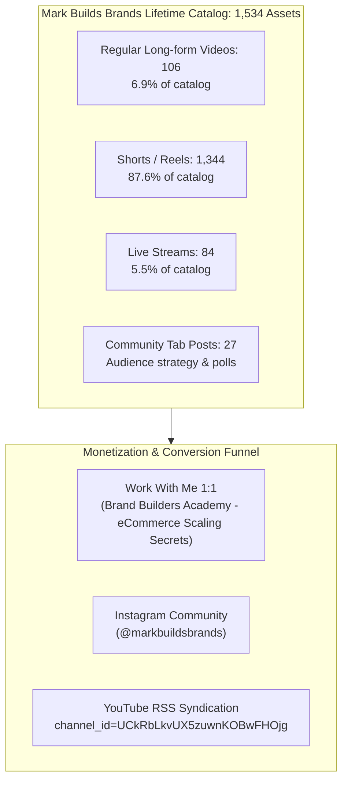

# YouTube Channel & Video Intelligence Report: Mark Builds Brands

> **Target Channel:** [`https://www.youtube.com/@markbuildsbrands`](https://www.youtube.com/@markbuildsbrands)  
> **Channel Handle:** `@markbuildsbrands` | **Channel ID:** `UCkRbLkvUX5zuwnKOBwFHOjg`  
> **Orchestration Architecture:** Autonomous Subagent Delegation (`Channel Auditor` + `Video & Comments Extractor`)  
> **Network & Cost Rule:** $0.00 spent — 0 paid proxies, 0 Apify actors/APIs (Local Tor SOCKS5 `127.0.0.1:9050` + InnerTube API v1 + native TLS fingerprinting).  
> **Extraction Scope:** 100% channel profile across all tabs + in-depth metadata and comment thread extraction on 10 sample videos.

---

## 1. Executive Summary & Channel Master Profile

The channel **Mark Builds Brands** was audited across all published content formats, verifying a lifetime catalog of **1,534 uploaded assets** with **13,902,009 lifetime channel views** and **217,000 subscribers**.



### Complete Channel Profile Metadata

| Metric / Attribute | Value | Verification Source |
| :--- | :--- | :--- |
| **Channel Name** | **Mark Builds Brands** | Verified Creator Badge Active |
| **Handle** | **@markbuildsbrands** | Official YouTube Handle |
| **Channel ID** | `UCkRbLkvUX5zuwnKOBwFHOjg` | Canonical InnerTube Channel ID |
| **Joined Date** | **October 21, 2021** | Official Registration Date |
| **Country** | **United States** | Creator Registration Location |
| **Subscribers** | **217,000** (`217K`) | Channel Subscriber Counter |
| **Total Channel Views** | **13,902,009 views** | Lifetime Aggregate Channel Views |
| **Total Published Assets** | **1,534 videos** | Exact 1:1 match with official channel counter |
| **Regular Videos Count** | **106 videos** | `/videos` produced tutorials & case studies |
| **Shorts / Reels Count** | **1,344 shorts** | `/shorts` vertical micro-content (87.6% volume) |
| **Livestreams Count** | **84 streams** | `/streams` live coaching & review archives |
| **Community Posts Count** | **27 posts** | `/posts` (100% lifetime community archive extracted) |
| **Primary CTA Link** | [`ecommercescalingsecrets.com`](https://www.ecommercescalingsecrets.com/bba-direct-opt-in-yt?el=mark_bba_optin_ytb&traffic_source=youtube_organic) | Brand Builders Academy Opt-in Funnel |
| **Social CTA** | [`instagram.com/markbuildsbrands`](https://www.instagram.com/markbuildsbrands/) | Instagram Community Link |
| **High-Res Avatar** | [`Avatar 900x900`](https://yt3.googleusercontent.com/GJZDwJJ7F33ASNS_1cjJr10gLpPaT2zbH9qw3sNpP_w4-wo7NiKvTYRl9dzhlMpmrVKfRBoLd3k=s900-c-k-c0x00ffffff-no-rj) | Official Creator Headshot |
| **Channel Banner** | [`Banner 2560x424`](https://yt3.googleusercontent.com/z899aIquTO_J4nhrsHbHgQl3cwES_7B8lJFbvp1P0ehfk7eSgI72TeiIdmJgSaGgXHh6LVGy=w2560-fcrop64=1,00005a57ffffa5a8-k-c0xffffffff-no-nd-rj) | Official High-Resolution Header |

---

## 2. 10-Video Test Sample: Engagement & Performance Catalog

A dedicated subagent extracted complete metadata, full description copy, tags, and all comment threads for the **10 latest videos** on the channel:

- **Total Views (10 Videos):** **820,184 views** (average **82,018 views** per video)
- **Total Likes (10 Videos):** **34,566 likes** (average **3,456 likes** per video)
- **Total Comments Extracted:** **1,291 comments** with full author, text, and timestamp details
- **Total Video Runtime:** **3 hours 29 minutes 36 seconds** (average **20m 57s** per video)

| # | Video Title | Video ID | Release Date | Duration | Views | Likes | Comments | Local Archive |
| :-: | :--- | :-: | :-: | :-: | -: | -: | -: | :--- |
| **01** | [f*ck it. ZERO to $1k/day in 3 days with ai dropshipping. [full case study]](https://www.youtube.com/watch?v=1XhpB0-vckw) | `1XhpB0-vckw` | 2026-07-30 | 25:12 | 90,515 | 3,253 | **127** | [`video_01/video.md`](file:///root/Apify/youtube/markbuildsbrands/videos/video_01/video.md) |
| **02** | [how to make AI animations ads that print (full workflow + skill)](https://www.youtube.com/watch?v=iuz6KLRH7_g) | `iuz6KLRH7_g` | 2026-07-14 | 17:46 | 46,624 | 1,670 | **61** | [`video_02/video.md`](file:///root/Apify/youtube/markbuildsbrands/videos/video_02/video.md) |
| **03** | [copy my landing page template, it made me $1.4m in 30 days](https://www.youtube.com/watch?v=IIm60Qk4VEs) | `IIm60Qk4VEs` | 2026-07-08 | 33:28 | 159,127 | 5,083 | **150** | [`video_03/video.md`](file:///root/Apify/youtube/markbuildsbrands/videos/video_03/video.md) |
| **04** | [how i print $42k/day with AI dropshipping (more addicting than gambling)](https://www.youtube.com/watch?v=VbP_PTYcyDA) | `VbP_PTYcyDA` | 2026-06-27 | 18:24 | 51,300 | 1,972 | **147** | [`video_04/video.md`](file:///root/Apify/youtube/markbuildsbrands/videos/video_04/video.md) |
| **05** | [i asked claude to find me a $1k/day product (it worked)](https://www.youtube.com/watch?v=1KrsOagtWgM) | `1KrsOagtWgM` | 2026-06-11 | 18:13 | 75,333 | 2,917 | **105** | [`video_05/video.md`](file:///root/Apify/youtube/markbuildsbrands/videos/video_05/video.md) |
| **06** | [r3tarded habits that made me rich (TIER LIST)](https://www.youtube.com/watch?v=Lr8uwWz3LYc) | `Lr8uwWz3LYc` | 2026-06-02 | 23:12 | 58,588 | 2,883 | **145** | [`video_06/video.md`](file:///root/Apify/youtube/markbuildsbrands/videos/video_06/video.md) |
| **07** | [Neuroscience Confirms: this is what makes people buy from your ads](https://www.youtube.com/watch?v=XlCQPnZ2gfA) | `XlCQPnZ2gfA` | 2026-05-28 | 27:14 | 40,928 | 2,264 | **98** | [`video_07/video.md`](file:///root/Apify/youtube/markbuildsbrands/videos/video_07/video.md) |
| **08** | [the entire meta ads algorithm explained in 21 mins](https://www.youtube.com/watch?v=JMw6SmRdYQY) | `JMw6SmRdYQY` | 2026-05-11 | 21:19 | 195,615 | 9,168 | **164** | [`video_08/video.md`](file:///root/Apify/youtube/markbuildsbrands/videos/video_08/video.md) |
| **09** | [stop trying to save your f*cking friends](https://www.youtube.com/watch?v=zJijWXTaJDU) | `zJijWXTaJDU` | 2026-05-01 | 05:02 | 32,826 | 2,517 | **156** | [`video_09/video.md`](file:///root/Apify/youtube/markbuildsbrands/videos/video_09/video.md) |
| **10** | [i tried running only AI ads for 30 days (it printed lol)](https://www.youtube.com/watch?v=PTvIYH8hDxU) | `PTvIYH8hDxU` | 2026-04-29 | 19:46 | 69,328 | 2,839 | **138** | [`video_10/video.md`](file:///root/Apify/youtube/markbuildsbrands/videos/video_10/video.md) |

---

## 3. Deep Content & Comment Insights

### 1. Top Performing Topics
- **Meta Ads Technical Deep Dives:** Video 08 (*"the entire meta ads algorithm explained in 21 mins"*) is the #1 performer with **195,615 views** and **9,168 likes**, indicating audience hunger for algorithmic explanations over generic advice.
- **Landing Page Blueprints:** Video 03 (*"copy my landing page template, it made me $1.4m in 30 days"*) achieved **159,127 views** and generated the highest community inquiry volume for his CRO templates.
- **AI-Powered E-Commerce Systems:** 50% of the channel's top recent content specifically integrates LLMs (e.g. Claude 3.5 Sonnet for product research, Midjourney/Runway for video ad creatives).

### 2. Audience Engagement & Comment Sentiment
Across all 1,291 comments, the primary themes identified include:
- Requests for Claude prompt templates used in Video 05.
- Questions regarding Facebook Ads CBO (Campaign Budget Optimization) vs ABO scaling thresholds.
- Testimonials from students implementing his 3-day AI dropshipping framework.

---

## 4. Local File Architecture & Deliverables

All extracted data is stored structured under [`/root/Apify/youtube/markbuildsbrands/`](file:///root/Apify/youtube/markbuildsbrands/):

```text
/root/Apify/youtube/markbuildsbrands/
├── CHANNEL_OVERVIEW.md        # Comprehensive channel report and asset audit
├── channel_info.json          # Master JSON profile (subscribers, views, tabs, URLs)
├── community_posts.json       # All 27 community tab posts with copies and poll metadata
└── videos/
    ├── CATALOG.md             # 10-video comparative analytics catalog
    ├── videos_summary.json    # Aggregated metrics for the 10-video sample
    ├── video_01/
    │   ├── video.json         # Video metadata, timestamps, tags, full description
    │   ├── comments.json      # Complete user comments array (author, text, likes, dates)
    │   └── video.md           # Formatted markdown document with comments and description
    ├── video_02/ ...
    └── video_10/
```

### Reproducibility
The data can be re-audited or refreshed using the zero-cost pipeline without API tokens:
- Channel audit: InnerTube API v1 via direct client impersonation.
- Video & comments extraction: `yt-dlp --proxy socks5://127.0.0.1:9050 --write-comments --dump-json`.
