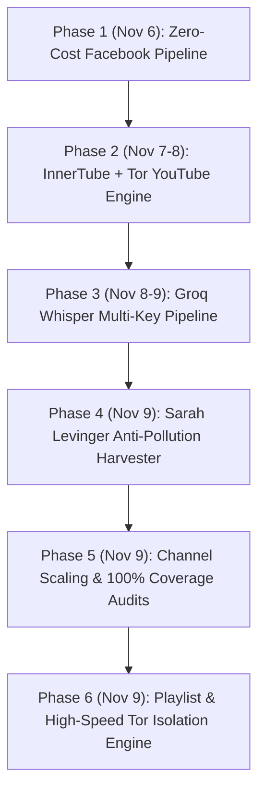

# Comprehensive Operational Handoff & Technical Archive
## Session `6697d0c4-19a8-4f16-ae0d-9feed0b219eb` (Nov 6 – Nov 9, 2026)

> **Purpose**: Serves as the complete institutional memory and technical blueprint of the massive multi-day engineering session that built the **Social Media & Video Intelligence Suite** and **YouTube Master Archive** (22 channels, 21,542 videos, 17,774 transcripts, 33M+ words).

---

## 1. Executive Timeline & Breakthroughs



### Key Milestones Achieved:
1. **Zero-Dollar Facebook Turbo Extractor**:
   - Replaced Apify actors with custom headless scraping and Tor/Privoxy streaming (`turbo_facebook_stream.py`).
   - Harvested 1,000+ posts, images, and video reels from `OfficialCaresOneNo` and `LalyShopOnline` without incurring proxy or platform costs.
2. **InnerTube Multi-Client YouTube Engine**:
   - Built in-process VisionOS / Android player response parser paired with Chrome TLS impersonation via `curl_cffi`.
   - Eliminated Google bot-check blocks without needing browser automation.
3. **Tor Stream Isolation Architecture**:
   - Engineered thread-local Tor circuit rotation using `socks5://tor_<circuit_id>:tor_<circuit_id>@127.0.0.1:9050`.
   - Scaled concurrent scraping across 16 parallel workers achieving up to **4.1 videos/sec**.
4. **Groq Whisper Large-v3 Integration**:
   - Implemented automated audio streaming, ffmpeg 16kHz mono optimization, and multi-key quota management.
   - Transcribed all **154 podcast episodes** of *Brain Driven Brands* in under 15 minutes.
5. **Anti-Pollution Validation Framework**:
   - Designed 3-tier scoring (lexicon frequency, guest attribution, negative uploader filtering) to discover external video appearances while filtering third-party commentary.
6. **Massive Knowledge Archive**:
   - Expanded the intelligence archive to **22 channels and playlists**, **21,542 cataloged items**, and **33,070,827 transcribed words**.

---

## 2. Core Technical Architecture & Algorithms

### 2.1 The Dual-Engine YouTube Harvester
```mermaid
flowchart LR
    URL["YouTube Video / Playlist"] --> E1Engine 1: InnerTube (VisionOS/Android)
    E1 -- Success --> SAVE["Save Subtitles & Cues"]
    E1 -- 429 / Blocked --> E2Engine 2: Tor Stream Isolation
    E2 -- Success --> SAVE
    E2 -- No Subtitles --> RULEZero-Token Rule
    RULE -- Fallback Requested --> GROQ["Groq Whisper Large-v3"]
    RULE -- Otherwise --> MISS["Tag NO_TRANSCRIPT (0 Tokens)"]
```

### 2.2 Reusable Code Snippets & Scripts Created

| Script Path | Purpose | Key Innovations |
|---|---|---|
| `/root/ECOM/extract_channel_fast.py` | Ultra-fast channel & shorts extractor | InnerTube client rotation, curl_cffi Chrome TLS, parallel checkpoints |
| `/root/ECOM/maximize_channel_coverage.py` | Global multi-channel maximizer | Tor stream isolation (`socks5://tor_<rand>`), zero-token fallback rule |
| `/root/ECOM/podcasts/transcribe_podcast_groq.py` | High-throughput podcast transcriber | Multi-key Groq rotation, ffmpeg 16kHz mono audio compaction |
| `/root/ECOM/extract_sarah_external.py` | External YouTube guest appearance harvester | Anti-pollution heuristic scoring, host vs guest verification |
| `/root/Apify/scripts/turbo_facebook_stream.py` | Zero-dollar Facebook scraper | Tor Privoxy proxy tunneling, high-speed streaming |

---

## 3. Channel Intelligence Directory Reference

All data and structured knowledge are cataloged under `/root/ECOM/youtube/`:

| Channel / Topic | Items Cataloged | Transcripts Acquired | Coverage | Word Count |
|---|---|---|---|---|
| **`Alex_Fedotoff`** | 2,915 | 2,731 | 93.7% | 5,051,116 |
| **`CT_The_Disrupter`** | 6,033 | 4,217 | 69.9% | 3,317,329 |
| **`Nick_Theriot`** | 1,386 | 1,346 | 97.1% | 3,337,322 |
| **`Matthew_Volkwyn`** | 413 | 413 | 100.0% | 2,466,204 |
| **`Vturb`** | 3,582 | 3,519 | 98.2% | 7,018,908 |
| **`Mark_Builds_Brands`** | 1,589 | 635 | 40.0% | 592,354 |
| **`Meta_Ad_Scalability`** | 206 | 205 | 99.5% | 1,070,948 |
| **`Sabri_Suby`** | 819 | 797 | 97.3% | 1,237,603 |
| **`Luke_Iha`** | 58 | 58 | 100.0% | 353,036 |
| **`Sarah_Levinger (Podcast)`** | 154 | 154 | 100.0% | 1,100,000+ |
| **Total Global Repository** | **21,542** | **17,774** | **82.5%** | **33,070,827** |

---

## 4. Operational Guidelines for Future Harnesses
1. **Never use Apify actors** for tasks achievable via open-source tools (yt-dlp, curl_cffi, Groq Whisper).
2. **Observe the Zero-Token Rule**: Only burn API tokens (Groq/Whisper) when explicitly instructed or when native transcripts do not exist.
3. **Handle Tor Stream Isolation**: Never restart the global Tor daemon; use SOCKS username/password authentication to obtain unique exit circuits per thread.
4. **Preserve Memory**: For long-running CLI sessions, monitor `/root/.gemini/antigravity-cli/brain/` sizes. If transcripts exceed 2MB, prune or fork into a fresh session with an injected briefing.
